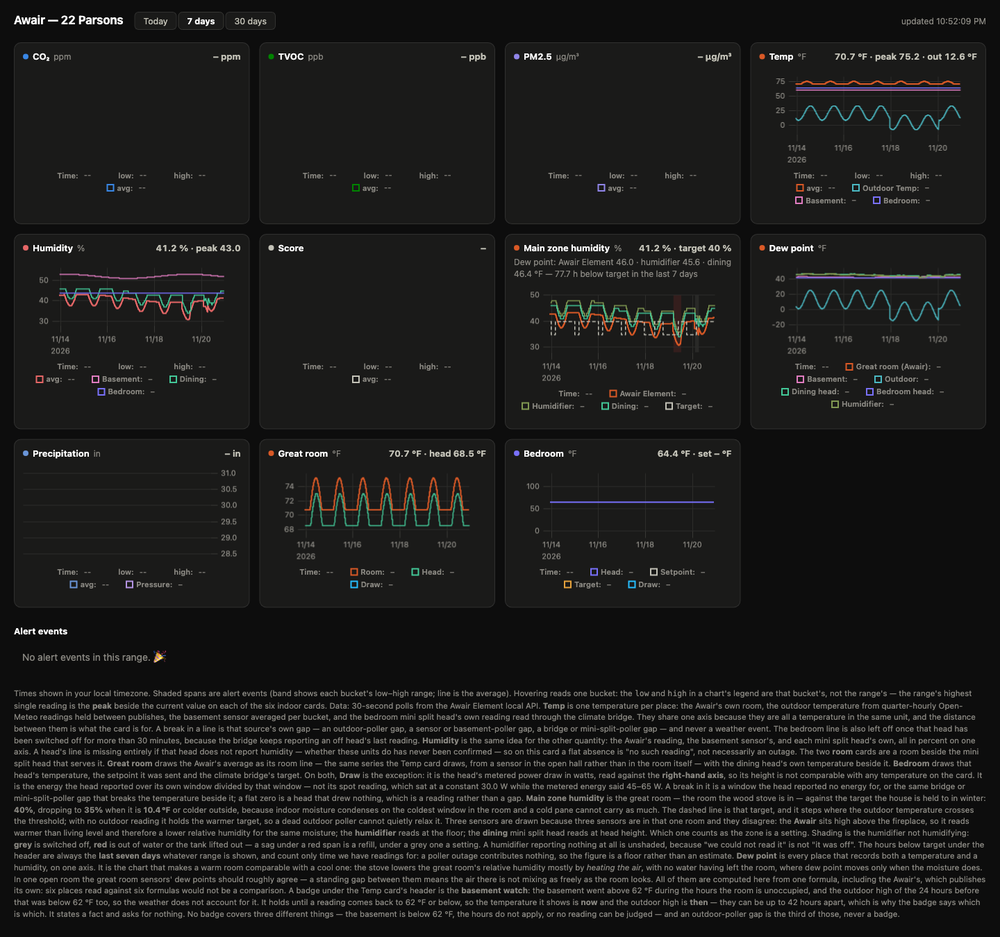
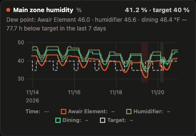
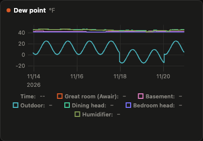

# The humidifier feed, dew point, and the main zone against a target (#161)

What this branch adds to the dashboard, shown against a **synthetic** database.
No VeSync account was contacted to make any of this: the rows were written by a
scratch seed script (eight days of made-up readings for every feed, with one
out-of-water stretch and one switched-off stretch for the humidifier, and a
cold snap outdoors), and the app was started locally with
`AWAIR_DB=<that file> TEMPERATURE_UNIT=F gunicorn -b 127.0.0.1:8197 'awair.web:create_app()'`.
The screenshots are headless Chrome at the 7-day range.

## The whole page

Two new cards, **Main zone humidity** and **Dew point**, beside the existing
ones. (The CO2 / TVOC / PM2.5 / Score cards are empty only because the seed
wrote no values for them.)

## Main zone humidity

- The thick line is the zone's own sensor (`AWAIR_MAIN_ZONE_FEED`, default the
  Awair); the humidifier's own reading and the dining head's are drawn beside it.
- The dashed line is the target. It steps from 40 % to 35 % where the seeded
  outdoor temperature goes to -12 °C or colder, and back.
- The red wash is the seeded out-of-water stretch, the grey one the seeded
  switched-off stretch.
- The line under the header prints the three great-room dew points side by
  side and the hours below target over the last seven days (77.7 h in this
  made-up week).

## Dew point

One line per feed that records a temperature and a humidity: the Awair, the
basement, outdoors, each mini split head, and the humidifier.

## `/health` on this database

`GET /health` answered 200 with `"status": "ok"`, `"stale": []` and
`"not_configured": []`, because the seed wrote humidifier rows. The other two
states (a humidifier table that has never held a row reads `not_configured`
and stays 200; one that has rows and went quiet reads `stale` and is 503) are
covered by `tests/test_web_health.py`, not shown here.

## What was not exercised

- No real Levoit Superior 6000S and no real VeSync login. The poller's device
  path is tested with the library's own classes fed a hand-built
  `Superior6000SResult` payload (`tests/fixtures/superior_6000s_status.json`),
  with its single HTTP call mocked.
- Phone widths and the light palette were not screenshotted.
